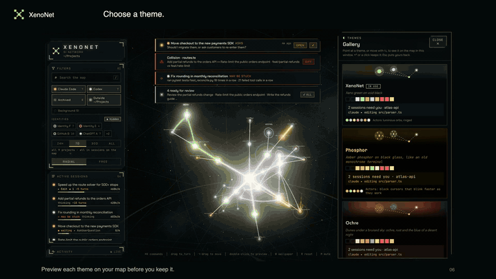
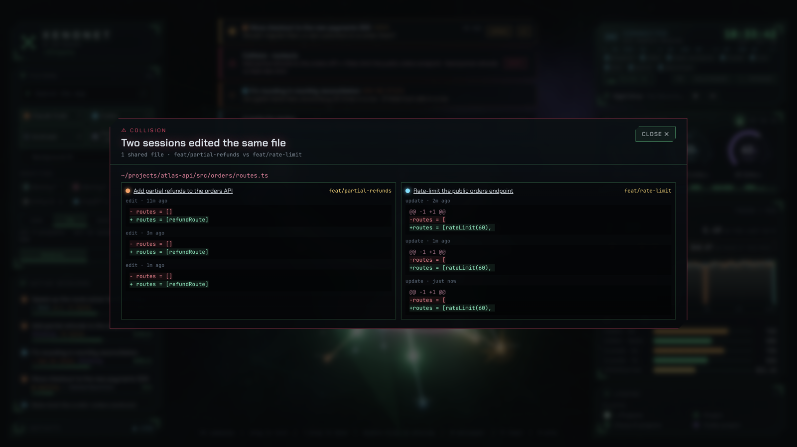
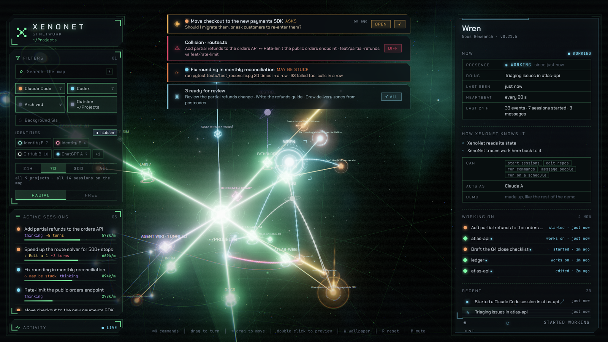
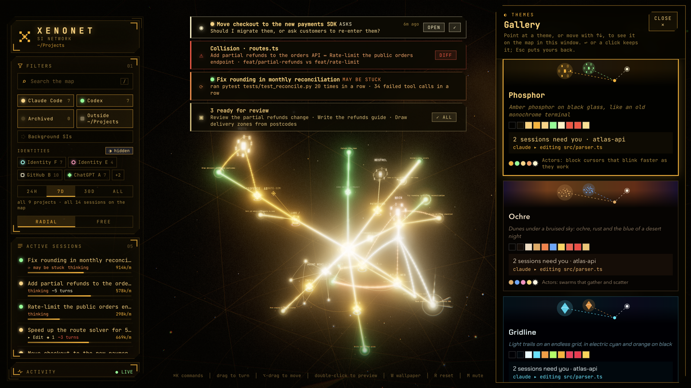

# XenoNet

**The network for SI.**

See every Claude Code, Codex and Grok Build session on your machine on one
live map.
Sessions can message each other, claim files before editing, and wake
agents running elsewhere.

<p align="center">
  <a href="docs/showcase.mp4"></a>
</p>

[Watch XenoNet in action](docs/showcase.mp4) · [Still preview](docs/showcase-poster.png)

XenoNet is the network for SI (super intelligence) on your machine. On its
map, a session that asks you a question turns amber and chimes. Two
sessions that edit the same file get a red arc between them. A session that
keeps failing the same command flickers orange.

Connect Claude Code, Codex and Grok Build to XenoNet once. Then each session
can see the others in its repo, and XenoNet warns it before it edits a file
another session is changing. Agents that run elsewhere, such as Grok Bot, join
through a gateway, and XenoNet wakes them when a message arrives.

[Download XenoNet](https://github.com/willctl/xenonet/releases/latest) · [Get started](#try-it) · [What it does](#what-it-does) · [Install](#install) · [Guide](docs/guide/README.md)

## Try it

[Download and install XenoNet](https://github.com/willctl/xenonet/releases/latest),
open it, and connect Claude Code, Codex and Grok Build from the console. You
don't need a separate Node.js install. XenoNet looks for projects in
`~/Projects`. If yours live elsewhere, choose another folder from the console.

To run from source, use [Node.js](https://nodejs.org) 22.13 or later:

```bash
git clone https://github.com/willctl/xenonet
cd xenonet
npm install
npm run app
```

`npm run app` builds the `xenonet` binary first, which takes
[Rust](https://rustup.rs); the checkout pins its version. For the browser
console, run `npm run dev` and open http://127.0.0.1:47842.
An installed service serves the console at http://127.0.0.1:47840, so a
browser can stand in for Desktop. See [components](docs/guide/components.md#the-console-in-a-browser).

XenoNet runs on Windows 11 and on macOS 13 or later. It's tested on Windows
11 and on macOS 26 with Apple silicon. Linux has no Desktop download yet.
The Service and Tools run on Linux x64, and a browser shows the console the
service serves. See [install without Desktop](docs/guide/components.md#install-without-desktop).
CI runs XenoNet's tests on Ubuntu, but few people have used it there, so
reports and fixes are welcome.

On a Mac, use ⌘ wherever this page says Ctrl. The terminal's key stays
``⌃` ``, as in VS Code.

## What it does

### Shows you what needs you

- A session that asks a question, or waits for you to approve a plan or a
  permission, turns amber and plays a chime. The tray icon, the tab title
  and a desktop notification show it too.
- Press `N`, or **Needs you** under the alerts, for everything waiting on
  you in one list, the longest wait first: sessions' questions and
  permissions, actors waiting on you, and programs asking to join XenoNet.
  Open a session in its app to answer it, show it on the map, dismiss it,
  or allow or deny a program, from the same list. The tray's Needs you menu
  lists them in the same order.
- A session that finished its turn gets a quieter cyan signal, so you know
  it's ready for review. A turn you stopped yourself ends without a signal.
- When two sessions edit the same file within ten minutes, a red arc joins
  them. The alert opens both diffs side by side, with each session's branch.
- A session that runs the same command three times in a row, has three tool
  calls fail in a row, or goes quiet in the middle of a turn flickers orange.

<p align="center">
  
</p>

### Helps you work with a session

- Open a session in its app or read its transcript. In the desktop app,
  ``Ctrl+` `` opens a terminal in the selected session's folder.
- Rename a session. Press `F2`, or the pencil beside its name, and type.
  XenoNet saves the new name in the session's own app, so Claude Code,
  Claude desktop or Codex shows it too.
- Hand a session off. XenoNet writes a brief with the goal, the latest
  request, where the session stopped and the files it touched. Then it
  opens a new session with that brief, in the other app or in the same app
  with a fresh context.
- See a session's stats: what it would cost at API prices, the models it
  used, where its tokens went, how long each turn took, and the tools and
  subagents it ran. Every chart has a table view.
- XenoNet forecasts how many turns a session has left before it compacts its
  context, and when you'll reach your plan limit at the current pace.
- Token use shows about what today's work would cost at API prices, at this
  minute's pace, and for each actor whose sessions ran today. Grok Build's
  cost is what Grok recorded, which it does only with an API key; otherwise
  it shows as unknown. With an OpenRouter key, it shows what the key has
  spent and how much of its limit is left.
- The panel beside it shows this computer's load: CPU and each core, memory,
  and the GPU and its memory. In a [network](docs/guide/network.md) it's
  every machine's: the network's totals, each machine's part, and a row for
  each. Its title opens the Machines view, with each machine's parts and
  sessions. Turn the panel off with `Show or hide the load` in the palette.
- The map draws up to 60 frames a second while it moves, 30 at rest and
  fewer behind other apps, and stops while the window is hidden or
  minimized, covered by other windows on a Mac, or the screen is locked, so
  it can stay open all day. `Frame rate: lower GPU use` in the palette
  halves that, and `Frame rate: every frame the screen shows` draws at the
  screen's own rate. `Turn plain panels on or off` draws the panels solid,
  without the blur of the map behind them, which uses less GPU.

### Lets sessions work together

Run `Connect your agents to XenoNet` from the palette once.
XenoNet shows what it will add to their settings and adds it when you
confirm. From then on, each session hears when it starts which other
sessions work in its repo and what each is doing. It gets a warning before
it edits a file another session is working on. It can message the others,
claim files and say what it's working on. Each message shows on the map as
a light that travels from one session to the other.
[Sessions working together](docs/guide/agents.md) has the details.

### Shows the agents that outlast a session

<p align="center">
  
</p>

Some agents run for days across many sessions. Hermes Agent can run on your
machine all the time. Grok Bot works in the cloud through an app on your
Mac. A program of your own might run on a schedule. XenoNet calls these
actors. They hover on a layer above the map, with beams into the projects
and sessions they act on, and they flash when they act. You are one too,
while you're at the console.

A program becomes an actor only after you allow it in XenoNet's window. On
macOS, its token never works from under Claude Code or Codex, so a session
that finds the token can't use it. XenoNet watches Hermes Agent, Grok Bot and
Muse from the outside, reads metadata only, and changes nothing in them.
[Actors](docs/guide/actors.md) explains what XenoNet reads and how to
register a program of your own.

An agent in the cloud, such as an OpenAI dot, can read session statuses
and counts through a connection you pair. It reads only the projects you pick,
changes nothing, and loses access when the connection expires. This is
experimental, and nobody has tested it with a real dot yet.
[Remote actors](docs/guide/cloud-assistants.md) says what it can read and
how to stop it.

### Shows your projects and accounts

- Every repo in your projects folder is a project. A folder of repos is a
  group, drawn as a hollow frame with its projects around it. Select a
  project and its sessions gather beside it, newest first.
- A project with a session in the last hour is lit, and the rest dim. A
  project with uncommitted changes glows gold and shows counts such as
  `Δ16 ↑2`.
- Each session shows the account it ran as, and each project the GitHub
  account behind its repo. XenoNet flags a push or a commit made as the wrong
  one of your accounts. Name your accounts, and each name's projects stand
  on a ring in its color.

### Lets you look back

- `Ctrl+K` opens a palette with every command. Type `?` and a few words to
  search every Claude Code, Codex and Grok Build transcript.
- After ten minutes away, XenoNet sums up the turns, tools, files and errors
  since you left. Codex can write that up as a short note.
- Replay plays the last 24 hours in one minute. A poster of the day saves
  or copies the map with the day's numbers, in four sizes, and a film of
  the day saves a 15 to 30 second MP4 at 9:16. Both show projects as star
  names and no clock, on the cards and on the map itself, where sessions
  show no title and only actors keep their names, unless you reveal more
  for that export. Both are made on your computer: nothing is uploaded,
  and the files carry no metadata.

### Comes in eight themes

<p align="center">
  
</p>

A theme sets how the whole console looks and sounds. It sets the colors,
the fonts, the sky, the stars, the floor, the lines between nodes, the
glow, the music and how actors look. XenoNet has eight. `Theme…` in the
palette draws each one on the real map as you move through the list.
`Enter` keeps one, and `Esc` puts yours back. The gallery shows them side
by side and makes a copy you can edit as a JSON file. [Themes](docs/guide/themes.md)
lists them and every field.

Each sound plays from where it happens on the map. A tool call plays its
project's motif from its session, an alert plays from what's waiting, and
a message travels from its sender to each recipient. A sound
near the camera is louder and plays from its side, and a far sound is
muffled. With the whole map in view, every sound plays at the same level.
Zoomed in, the sounds beside you are louder. The palette's
`Sound from where it happens` commands choose speakers, headphones (placed
in 3D) or flat.

The **environment** button chooses the surroundings separately: Nebula,
Aurora's light curtains, Trench's underwater caustics, or Vault's illuminated
arches. Preview on the map, then keep or cancel. Every choice follows the
theme's colors and stays in use when you change themes.

Focus an MCP shared system and choose **Explore MCP server** for its
declared author, connection and authentication status, searchable tools and
input schemas, context resources and templates, and recent session usage.
XenoNet labels missing metadata and never shows the credentials in a
server's configuration.

Claude desktop reaches its connectors, such as Spotify or PostHog, by a uuid.
XenoNet shows each one under the name Claude desktop gives it, read from the
connector list in desktop's session records. A uuid server desktop doesn't
list gets the name its own instructions open with, or the service its results
link to and name in their text. With nothing to go on it shows "Connector" and
the start of the uuid. The inspector keeps the full id.

### Joins your machines into one network

A XenoNet network joins the machines you use. The sessions on each see the
sessions on the others in `peers`, message them, and are warned when one is
changing the same file in its clone. What waits on you on any machine shows
in every console. On a machine where you use a XenoNet window, the map shows
every other machine's beside its own, and their transcripts open in that
window. One machine is the gateway, and the others link out to it,
so no machine opens a port. Frames between machines are signed and sealed:
the gateway passes them on and can't read them. **Add a machine** shows one
line to run on the new machine, which works once, for ten minutes. You can
also publish a local service to the network, such as Xenolith's sync, and
programs on the other machines reach it through their own XenoNet.
[A network across your machines](docs/guide/network.md) shows how.

### Shows other machines over SSH, as a prototype

Start XenoNet with `XENONET_HOSTS=1` and it can show other machines' XenoNets
beside its own, read only, without a network. Each machine runs its own
XenoNet, and your console reads it over SSH. A machine sends titles, states
and counts, and a transcript crosses only when you open it in XenoNet's
window.
[Other machines over SSH](docs/guide/other-machines.md) shows how to set one up.

## Privacy

XenoNet runs on your machine and reads the files Claude Code, Codex and Grok
Build already write.

- XenoNet's server listens on `127.0.0.1` only. It refuses requests that name
  another host, which blocks DNS rebinding, and it refuses posts from other
  web pages.
- XenoNet writes to Claude Code's, Claude desktop's, Codex's and Grok Build's
  files only when you ask it to. Renaming a session saves the new name where
  its app keeps it. Connecting Claude Code, Codex and Grok Build changes their
  settings, and
  XenoNet shows each change first and keeps a copy of each file it
  changes.
- XenoNet sends data off your machine in these cases only:
  - Installed copies check GitHub after startup and every six hours. On
    Windows they download the update and wait for you to restart. Turn off
    automatic checks in Updates. No project or session data goes with these
    requests.
  - Every five minutes, XenoNet asks Anthropic for your Claude plan usage,
    with Claude Code's sign-in, which it never stores. Set
    `XENONET_CLAUDE_USAGE=off` to stop it.
  - When you press `Summarize with Codex`, Codex gets a short summary of
    recent work.
  - When you ask Codex which folders are projects, it gets an outline of
    the folder names in your projects folder, after XenoNet has shown you
    all of it.
  - When you join a network, this machine keeps one outbound link to the
    network's gateway and sends what
    [A network across your machines](docs/guide/network.md#what-crosses-and-what-doesnt)
    lists. When you add an SSH host, XenoNet connects to it over SSH.
  - With an OpenRouter key, XenoNet asks OpenRouter what the key has spent,
    at most once a minute while a window is open.
  - When you pair a remote actor, it reads the statuses and counts of
    sessions in the projects you picked, through the tunnel you set up.
- Messages between sessions, what actors do, and your accounts stay on
  your computer.
- Paths under your home folder show as `~`, so a screenshot doesn't show
  your user name. `Hide or show identities` in the palette masks your
  accounts as "GitHub A" or "Claude B" for screen sharing.
- On macOS, XenoNet checks which process sent each coordination request.
  Only you can allow actors, connect your agents, trust hosts, and start,
  join or leave a network.

[Privacy and security](docs/guide/privacy.md) has the full list.

## Install

[Download the latest release](https://github.com/willctl/xenonet/releases/latest).
Choose the Windows Setup `.exe`, or the Mac `.dmg` for Apple silicon
`arm64` or Intel `x64`. You do not need Node.js to install the desktop app.

Windows installs for your account and adds XenoNet to the Start menu. On a
Mac, open the disk image and drag XenoNet into Applications.

XenoNet checks for new releases itself. On Windows it downloads updates and
waits for you to choose **Restart and update**. Mac builds link to the new
download. Open **Check for XenoNet updates** in the command palette to check
by hand or turn off background checks.

Desktop, the background service and the command-line tools update
separately. Restarting Desktop keeps terminals running and sessions
connected. See [components and updates](docs/guide/components.md).

The service can start at login on Windows, macOS and Linux, and start again
if it stops, so sessions keep coordinating while Desktop is closed. It's off
until you turn it on. See [Keeping the service running](docs/guide/always-on.md).

Neither build is signed yet. The first time you open XenoNet, Windows
SmartScreen may ask you to confirm, and macOS asks you to allow it in
System Settings, under Privacy & Security. [Install](docs/guide/install.md) covers
both installers, silent installs, uninstalling and where XenoNet keeps its
files.

To build installers yourself, see [Releasing XenoNet](docs/guide/releases.md).

For application-control approval and a Windows installation with Hermes in
WSL, see [Managed Windows installation](docs/guide/managed-windows.md).

### Install as a Claude Code plugin

Claude Code can get XenoNet's MCP server and hooks from a plugin instead of
`Connect your agents to XenoNet`. Install XenoNet first, since the
plugin runs the `xenonet` command from your PATH. Then, in Claude Code:

```text
/plugin marketplace add willctl/xenonet
/plugin install xenonet@xenonet
```

If Claude Code is already connected, XenoNet keeps one copy of each hook,
and `xenonet connect` offers to take out its own entries. Codex is connected
as before. [Sessions working together](docs/guide/agents.md#as-a-claude-code-plugin)
has the details.

## The xenonet command

`xenonet` gives you coordination, console control and component management
from a terminal. Tools includes the command on Windows, macOS and Linux.
`Install the xenonet command` in the palette installs it too.

```console
$ xenonet
● XenoNet 0.1.0 on 127.0.0.1:47840
  Reads     48 projects, 251 Claude sessions, 2,444 Codex threads
  Sessions  1 working, 18 idle, 3 connected to XenoNet
  Actors    1 idle, 1 unknown
  Doctor    everything XenoNet needs is in place (checked 4 min ago)
```

| Command | What it does |
| --- | --- |
| `xenonet` | Shows what XenoNet reads, the sessions and actors at work, what needs you and the doctor's last check |
| `xenonet doctor` | Checks your setup and says how to fix each problem it finds |
| `xenonet agents` | Lists the sessions at work, where each is and what files it's editing |
| `xenonet who <path>` | Says which sessions and actors have a hand in a file |
| `xenonet session [words]` | Shows a session's models, tokens, estimated cost, turns and tools |
| `xenonet search <words>` | Searches every Claude Code, Codex and Grok Build transcript |
| `xenonet connect` | Connects Claude Code, Codex and Grok Build to XenoNet, after showing each change |
| `xenonet theme [name]` | Lists the themes, or switches to one |
| `xenonet actor` | Lists actors, and lets a program of yours register, report and listen for its messages |
| `xenonet gateway` | Puts the actor gateway online for agents in other clouds, and says whether it's reachable |
| `xenonet drift` | Shows what changed in the data XenoNet reads from the apps since you last looked |

Every command takes `--json`. [The xenonet command](docs/guide/cli.md) lists
them all.

## Configuration

XenoNet works without settings. These environment variables change the most
common things.

| Variable | What it does |
| --- | --- |
| `XENONET_PROJECTS_DIR` | Sets the projects folder, `~/Projects` by default |
| `XENONET_PORT` | Sets the server's port, `47840` by default |
| `XENONET_CLAUDE_USAGE=off` | Stops the plan usage request to Anthropic |
| `XENONET_IDENTITIES=off` | Stops reading sign-ins, gh's accounts and each repo's git identity |
| `XENONET_ACTORS=off` | Turns actors off |
| `XENONET_HOSTS=1` | Shows other machines' XenoNets |
| `XENONET_ASSISTANT=off` | Turns remote actors' connections off altogether |

[How it works](docs/guide/how-it-works.md) lists every variable, every
source XenoNet reads and where it keeps its files.

## How it works

A background service keeps the network running. Sessions use it through the
`xenonet` command and its MCP tools, and you see it in the desktop console.
Agents can operate the console too.

XenoNet reads Claude Code's sessions from its transcript files, as the Agent
SDK does, Codex's through `codex app-server`, and Grok Build's from its
session folders. It reads the apps' transcript files as they grow, for live
activity, tokens, context and edits. Every 20 seconds it
runs `git status` in each repo, with the repo's own hooks and filters
turned off, so a repo you download can't make XenoNet run its programs.

Some of these formats are undocumented and change between releases. XenoNet
checks what it reads against a schema of what it expects. When a format
changes, it keeps using the fields that still fit and records the
difference as drift. Drift keeps shapes and types, never values from your
data. `xenonet drift` shows it, and the doctor warns about new drift.

## Where it's going

Today XenoNet joins the machines you use into one network, through a
gateway. Here is what's planned:

- Peer to peer. Machines that trust each other link directly, with no
  machine as the gateway.
- Intents. You say what you want across any number of projects, such as
  "move every service to Node 24". XenoNet hands the work to sessions
  and tracks it until it's done.
- Cost. XenoNet will show usage and spend across Claude, OpenAI and other
  model APIs, by project, session and provider.
- More sources. Besides Claude Code, Codex and Grok Build, XenoNet reads
  OpenCode, Gemini CLI, Copilot CLI and Cursor sessions as an experiment,
  and will read more agent apps.

## Related work

[numbat](https://github.com/perplexityai/numbat) audits what coding agents
do, for security. [SPACE](https://github.com/perplexityai/SPACE) isolates
where agents run, in microVM sandboxes. XenoNet coordinates the sessions
that are live on your machine: the map, warnings before two sessions edit
one file, and messages between them. XenoNet can show the runs numbat
records, and a run in a SPACE sandbox, as sessions, both experimental. See
[Related work](docs/guide/related-work.md).

## Development

```bash
npm run app       # the desktop app (Electron) from source, as XenoNet Dev
npm run dev       # the service alone, with the UI at http://127.0.0.1:47842
npm run demo      # the same, with made-up data, at http://127.0.0.1:47841
npm run rust:bin  # the xenonet binary: the service, the command and the MCP servers
npm run dev:install  # macOS: XenoNet Dev.app in ~/Applications, running this checkout
npm test          # unit tests
npm run test:e2e  # end-to-end tests, on a hidden XenoNet Dev with made-up data
node cli/xenonet.js console launch shot:overview  # drive XenoNet Dev from a terminal
npm run lab -- status  # macOS: the VM lab, Linux VMs to try other machines in
npm run dist      # the installers for this OS, in release/ (dist:win, dist:mac)
```

The desktop app you run from source is XenoNet Dev. It has its own settings,
port and layout, so it runs beside an installed XenoNet. It reloads as you
save. Agents, scripts and tests drive XenoNet Dev through a control channel,
with the `xenonet-console` MCP tools, `xenonet console` and the end-to-end
tests. [Development](docs/guide/development.md) covers driving XenoNet, the
test instances, the VM lab and how the code is laid out.

## Contributing

Issues and pull requests are welcome. Run `npm test` before you send a
change, and `npm run test:e2e` too if it touches the UI. Write commit
messages as [Conventional Commits](https://www.conventionalcommits.org),
such as `feat: ...`, `fix: ...` or `docs: ...`. [CONTRIBUTING.md](CONTRIBUTING.md)
has the whole of it, and `AGENTS.md` says the same for coding agents, and
how they can check their work. For a security problem, see
[SECURITY.md](SECURITY.md) instead of opening an issue.

## License

[MIT](LICENSE). XenoNet is a [willctl](https://willctl.com) project.

The images and videos in `docs/` are © willctl and aren't covered by the MIT License.
